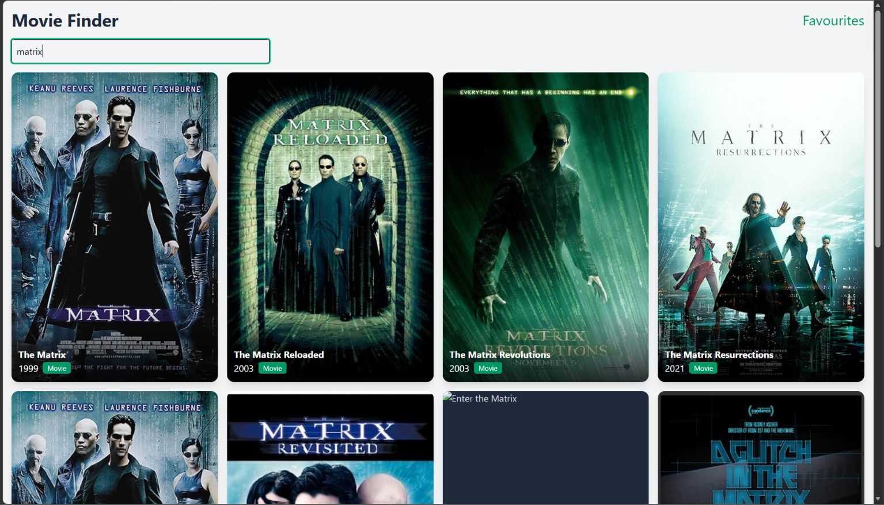

# Movie Finder

Search for movies and build a list of your favourites.

**[Live demo](https://movie-app-roan-gamma.vercel.app)**



## Features

- Search movies by title, with debounced input so the API isn't called on every keystroke
- Loading, error and "no results" states
- Movie details page with poster, plot and more
- Add and remove favourites, saved in localStorage so they survive a refresh
- Responsive layout from phone to desktop
- Smooth animations on cards and page elements

## Tech stack

- React 19 and TypeScript
- Vite
- Redux Toolkit for state
- React Router for navigation
- Tailwind CSS v4 for styling
- Framer Motion for animation
- Axios and the OMDb API for data

## Run it locally

1. Clone the repo and install dependencies:
```bash
   git clone https://github.com/rajan03-commits/Movie-app.git
   cd Movie-app
   npm install
```
2. Get a free API key from [OMDb](https://www.omdbapi.com/apikey.aspx).
3. Create a `.env` file in the project root:
```
   VITE_OMDB_API_KEY=your_key_here
```
4. Start the dev server:
```bash
   npm run dev
```

## What I learned

- Managing app state with Redux Toolkit slices
- Handling race conditions in async search with effect cleanup
- Deploying a Vite single-page app to Vercel with environment variables